# Conditional TimeGAN for Limit Order Book Simulation

**COMP3710 Project 2.7 — Time-Series Generation (Hard difficulty)**
Oliver Lam, 48030492

## Contents
1. [Overview](#1-overview)
2. [Feasibility review](#2-feasibility-review)
3. [Dependencies and reproducibility](#3-dependencies-and-reproducibility)
4. [Data, pre-processing and splits](#4-data-pre-processing-and-splits)
5. [Usage](#5-usage)
6. [Metric choice](#6-metric-choice)
7. [Results](#7-results)
8. [Resource profiling](#8-resource-profiling)
9. [Experiment history](#9-experiment-history)
10. [Microstructure autopsy](#10-microstructure-autopsy)
11. [Recommendation to the project manager](#11-recommendation-to-the-project-manager)
12. [Artificial Intelligence Usage Disclosure](#12-artificial-intelligence-usage-disclosure)
13. [References](#13-references)

---

## 1. Overview

### The problem
Backtesting trading and execution strategies needs large amounts of realistic market data, but high-frequency limit order book (LOB) data is expensive to licence. A generative model that produces realistic synthetic order books would let a quantitative trading team test strategies without that cost. Order books are harder to generate than generic time series, because every snapshot must obey hard microstructure rules:

1. **Positive spread:** the best bid is below the best ask (`P_bid,1 < P_ask,1`). A crossed book is a free arbitrage opportunity.
2. **Monotonic price ladders:** bid prices fall and ask prices rise across the 10 levels.
3. **Non-negative volumes** at every level.

The generated data should also reproduce the stylised facts of real returns: heavy tails and volatility clustering (Cont, 2001).

**The engineering dilemma.** Does TimeGAN's joint supervised and adversarial training actually *learn* these rules and realistic temporal behaviour, for each stock, better than an adversarial-only baseline from the TimeGAN paper (RCGAN)? Or does it produce crossed books, collapse into white noise or a single mode, or fail to tell stocks apart? And are the synthetic books reliable enough for backtesting?

### The approach
This project trains one TimeGAN conditioned on the stock ticker on LOBSTER Level 10 data for five stocks (AMZN, AAPL, GOOG, INTC, MSFT; 21 June 2012), rather than five separate models, and compares it against an RCGAN-style baseline with the same recurrent structure, trained with identical settings.

### How TimeGAN works
TimeGAN (Yoon, Jarrett & van der Schaar, 2019) extends the recurrent GAN architecture by combining it with 3 additional neural networks. These are a encoder and recover network that act as an autoencode to transform the features into a latent space that all the networks learn on. It also adds a supervisor network that learns to predict the next latent step from the previous step using real data.

Training has three phases: (1) the embedder and recovery are trained as an autoencoder; (2) the supervisor is trained on real latents; (3) all five networks are trained jointly. A generated sequence is produced from noise that is passed into the generator then the output is passed into the supervisor before being passed into the recovery network to produce the final output. This generation procedure is the main idea of TimeGAN's framework. An adversarial loss alone gives the generator a weak signal about how each step should follow from the previou. The supervisor acts as a way to increase the temporal signals to improve the capture of time-series dynamics. In the reference implementation the supervised loss itself is computed on real latents only, so it shapes the supervisor (and the embedder), and reaches the generator through the supervisor in its output path rather than as a direct gradient.

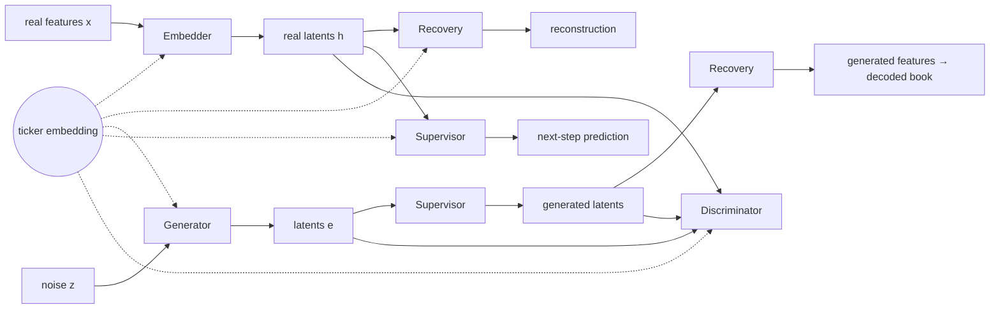
*Data flow of the conditional TimeGAN. The ticker embedding enters every network at every step (dotted). The baseline has only the generator and discriminator, working directly on features.*

### Conditioning

A learned ticker embedding is concatenated to the input of every network at every time step, following conditional GANs (Mirza & Osindero, 2014). The authors' reference code is unconditional; this conditioning is this project's extension. The paper's static features are generated alongside the sequence, whereas here the stock ticker is a given condition, because a user needs to choose which stock to simulate.

The RCGAN-style model (Esteban, Hyland & Rätsch, 2017) is TimeGAN's closest benchmark in the paper. Its generator maps noise plus the ticker directly to features, and its discriminator classifies feature sequences. It uses the same conditional 3-layer GRU blocks and bidirectional discriminator, but has no embedder, recovery or supervisor and is trained on the adversarial loss alone. At the final size its generator and discriminator have exactly the same parameter counts as TimeGAN's (Section 8), so differences in results can be attributed to TimeGAN's extra components. Because it shares TimeGAN's backbone rather than the original LSTM implementation, it is an RCGAN-*style* adaptation, not an exact reproduction. The script `scripts/train_rcgan_matched.sh` copies every shared setting from the TimeGAN run's saved configuration, so the two cannot drift apart.

### Implementation choices and departures from the reference code
| Setting | Choice | Evidence |
|---|---|---|
| GRU hidden size | 164 (the paper's 4 × number of features) | Capacity sweep: hidden 24 (reference code) underfits badly (EXP-004, EXP-006) |
| Latent size | 41 (= number of features; the paper uses ½ × features) | At hidden 164, latent 41 halves reconstruction error compared with 24 (EXP-006) |
| Phase 1 / phase 2 length | 20,000 / ~5,000 iterations | Phase 1 was still improving at 10,000 (EXP-007); phase 2 starts overfitting after ~4,500 (EXP-007) |
| Losses and weights | As the reference code (reconstruction 10·√MSE; generator: adversarial + adversarial on raw generator output + 100·√(supervised) + 100·moment loss) | — |
| Discriminator updates | 5 per iteration (`--d-steps`); the reference code uses 1 | With 1, the discriminator never left a constant output (EXP-009, EXP-010) |
| Learning rates | Discriminator faster than the other networks (`--d-lr` > `--lr`), the two time-scale update rule (Heusel et al., 2017) | Without it, each generator step undid what 5–10 discriminator steps had learned (EXP-011); with it, adversarial training worked (EXP-012) |
| Training window | 64 steps (the reference code and paper use 24) | At 24 steps, ladder violations appeared only late in 500-step generations and never within 24 steps (EXP-012) |
| Final learning rates | `--lr 3e-5` (generator, supervisor, embedder, recovery), `--d-lr 1e-4` (discriminator) | Faster generator than EXP-012 to counter undertraining. **Unintended side effect:** `--lr` also applies to phases 1 and 2, which therefore ran 33× slower than intended and left the autoencoder underfitted (Section 7.1, EXP-013) |

With identical settings, the final TimeGAN produced books that never broke an order-book rule, kept the two market regimes apart and roughly matched spreads, while the RCGAN baseline broke the price ladder on every step. Neither model reproduced realistic price dynamics: generated prices move as smooth, near-deterministic drifts, not as real tick-by-tick moves.

| Real (left) vs TimeGAN (right), AAPL | Real (left) vs RCGAN baseline (right), AAPL |
|---|---|
| 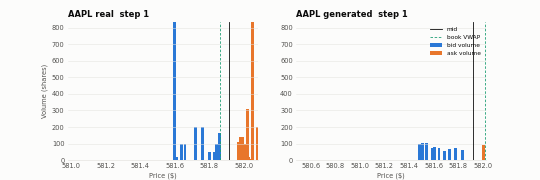 | 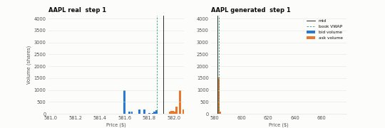 |

*Animated depth charts from the final models (every 5th second of a 500-second generation): bid (blue) and ask (orange) volume at each price, with the mid and the book VWAP. Both generated books start from the same real mid price. Note the different price axes: the RCGAN book has drifted tens of dollars away.*

---

## 2. Feasibility review

*As presented and checked off at the midpoint check-off on 27 October 2026. It is reproduced unchanged; what changed afterwards is recorded in [Experiment history](#9-experiment-history).*

### 2.1 User need, scope and acceptance criteria

The intended user of this prototype is a quantitative finance firm which requires large amounts of realistic market data to allow them to develop and back-test trading algorithms. Since access to high volumes of real historical data is expensive it is beneficial to develop a generative model that can produce synthetic LOB data which appears realistic. The prototype will be a single generator conditioned on the stock ticker, trained on the five LOBSTER samples (AMZN, AAPL, GOOG, INTC, MSFT; 2012-06-21). The purpose of the prototype is to see if the TimeGAN model is capable of learning the structural constraints of a LOB.

Acceptance criteria (on 500-step generations, per ticker, scored against the test hour):

| Criterion | Definition | Target |
|---|---|---|
| **1. Validity** | Share of snapshots breaking an invariant: crossed or locked spread, non-monotonic ladder, negative size | < 1%, and lower than the RCGAN baseline *(real: 0%)* |
| **2. Conditioning** | Per-ticker VWAP variance and VWAP–mid distance; spread in ticks | VWAP stats within ±30% of real and distinct across tickers; INTC/MSFT one-tick spread in ≥ 90% of steps *(real ≈ 99%)*; AMZN/AAPL/GOOG keep wide spreads *(real mean 13–27 ticks)* |
| **3. Volatility clustering** | ACF of returns and of \|returns\| | \|ACF r, lag 1\| < 0.05; ACF \|r\| positive up to 60 s, lag 1 within ±0.05 of real *(real: 0.07–0.16)* |
| **4. Spec metrics** | KL on spread and mid returns (tick-aligned bins); SSIM on depth heatmaps | Reported against the real-vs-real reference as well as the spec's KL ≤ 0.1 and SSIM > 0.6, with a critique of SSIM |
| **5. Resources** | Wall-clock training time and peak VRAM for a full run | < 30 min and < 2 GB on one Tesla T4 |

### 2.2 Model choice and course concepts

I will implement a TimeGAN (Yoon, Jarrett & van der Schaar, 2019) conditioned on the stock ticker (Mirza & Osindero, 2014), in the Hard difficulty band, and compare it against an RCGAN-style baseline (Esteban et al., 2017). Recurrent networks (GRUs) suit time-series data because their hidden state carries information forward, so each generated step depends on its history. TimeGAN adds three networks to a recurrent GAN. An embedder and a recovery network learn a compact latent space from real books. A supervisor learns real next-step transitions, which gives the generator a direct signal for temporal dynamics that an adversarial loss alone captures poorly.

Books are resampled to a 1 s clock-time grid using the last state at or before each step, so there is no look-ahead. Each ticker is split chronologically into train (09:30–14:00), validation (14:00–15:00) and test (15:00–16:00). Each step has 41 features: the mid log-return, the price offsets from the mid, and log sizes. Min-max scaling is fitted on the training split and shared across tickers, so the model must learn each stock's identity. Models train on 24-step windows, the paper's length, and generate 500 steps. A constrained representation (log spread and log level gaps) is valid by construction and gives a comparison point.

### 2.3 Preliminary feasibility evidence

**Baseline smoke test.** I ran 300 iterations of the conditional RCGAN baseline, which uses the same GRU backbone as TimeGAN, on all five tickers (80,880 training windows). Training ran end to end on both CPU and GPU and saved losses, loss plots and checkpoints. Runs with the same seed reproduced identical losses.

| Device | Time per iteration | 300 iterations | Peak VRAM | Parameters |
|---|---|---|---|---|
| Tesla T4 | 0.027 s | 8.1 s | 130 MB | 45,866 |
| PC CPU | 0.29 s | 88 s | – | 45,866 |

**Resource estimate.** A TimeGAN iteration involves five networks instead of two, so I expect it to cost roughly 3–4× an RCGAN iteration. With 10,000 iterations per phase, as in the reference code, a full run should take about 15–20 minutes and use under 1 GB of VRAM on one T4. The first TimeGAN run will confirm these estimates.

### 2.4 Risks, budget and fallback

| Risk | Signal | Mitigation |
|---|---|---|
| **Ticker collapse** | All stocks get similar spreads and VWAP statistics | D also receives the ticker; global scaling; per-ticker metric checks |
| **Memorisation** (one day of overlapping windows) | Generated windows almost identical to training windows | Small model; nearest-neighbour check against training windows; compare with a larger configuration |
| **Collapse to zero returns** (94–96% zeros for INTC/MSFT) | No non-zero moves, so the ACF of \|r\| is flat | Report the share of zero returns and the distribution of non-zero moves, not just KL |
| **GAN instability** | Oscillating or diverging losses; D accuracy stuck near 100% | 2 G steps per D step; D-loss threshold; 2–3 seeds |
| **Test hour out of distribution** (AAPL selloff, end-of-day volume) | Metrics much worse on test than on validation | Report both hours; use it as a failure case in the error analysis |
| **KL sensitive to bins and length** | KL changes with bin count or sample length alone | Tick-aligned bins; compare with real-vs-real KL at the same length |

- **Next experiment:** build the TimeGAN embedder, recovery and supervisor, then compare a joint-training run against RCGAN on the unconstrained representation.
- **Budget:** one T4 VM. At about 0.03 s per iteration, 10,000 iterations take about 5 minutes, so every experiment can be run with multiple seeds.
- **Fallback:** an unconditional TimeGAN on AMZN only.

---

## 3. Dependencies and reproducibility

| | Local development and evaluation | GPU training (Kaggle notebook) | Early GPU runs (Tesla T4 VM, EXP-002 to EXP-005) |
|---|---|---|---|
| Hardware | CPU | NVIDIA Tesla T4, 15 GB (one GPU used) | NVIDIA Tesla T4, 15 GB |
| Python | 3.14.7 | 3.13.15 | 3.10.21 |
| PyTorch | 2.14.1+cpu | 2.11.0+cu128 (CUDA 12.8) | 2.14.1+cu126 |
| NumPy | 2.5.4 | 2.1.3 | not recorded |
| pandas | 3.1.0 | 2.3.3 | not recorded |
| matplotlib | 3.11.2 | 3.10.0 | not recorded |

The GPU VM used for the early runs became unavailable, so all runs from EXP-006 onwards were trained on a Kaggle T4. Pillow (installed with matplotlib) is needed for the GIFs. No other packages are required.

**Reproducibility.**
- Every run sets the Python, NumPy and PyTorch seeds (`--seed`) and saves its full configuration, package version and resource figures to `config.json`; checkpoints store the min-max statistics, which `predict.py` checks against the data before scoring.
- Runs with the same seed on the same device reproduce identical losses (checked on CPU, EXP-001), and the same configuration reproduced EXP-003's reconstruction error on a different machine and PyTorch version (EXP-006).
- CPU and GPU runs with the same seed are **not** bit-identical: the GRU kernels round differently, and the adversarial feedback loop amplifies differences of about 1e-5 over training (EXP-002). Each comparison therefore uses runs from a single device.
- All final results come from **one seed** (seed 0). Repeating them over 2–3 seeds, as originally planned, did not fit the compute budget.
- All paths and hyperparameters are command-line arguments; nothing is hard-coded.

---

## 4. Data, pre-processing and splits

### 4.1 Data
The free LOBSTER Level 10 samples for AMZN, AAPL, GOOG, INTC and MSFT on 21 June 2012, 09:30–16:00 ([LOBSTER sample files](https://lobsterdata.com/info/DataSamples.php)). Each stock has a message file and an order book file whose rows align one-to-one. The order book file has 40 columns: ask price, ask size, bid price and bid size for each of 10 levels, with prices stored as dollars × 10,000. Empty levels would be filled with dummy prices (±9,999,999,999); the loader masks these, although none occur in these samples. The data is stored outside the repository and passed in with `--data-dir`.

### 4.2 Pipeline (`dataset.py`)
1. **Load** each ticker, convert prices to dollars, mask dummy levels and check the books are valid.
2. **Resample to a 1 s clock-time grid.** The book at each grid time is the state after the last message at or before that time, so only past information is used (no look-ahead).
3. **Compute features** (Section 4.4).
4. **Split chronologically** per ticker (Section 4.3).
5. **Fit min-max scaling on the training split only** and apply it to every split (Section 4.5).
6. **Build sliding windows** within each split, so no window crosses a split boundary.
7. **Serve `(window, ticker_id)` samples**, with tickers mixed in every batch.

**Why clock time.** Sampling in event or trade time makes returns look closer to Gaussian, with weaker volatility clustering (Clark, 1973; Ané & Geman, 2000), which would hide one of the properties being evaluated. A fixed event count would also cover very different amounts of real time per stock. Event time was therefore considered and rejected.

**Why a 1 s step.** The data audit compared 1, 2 and 5 s grids. Coarser grids reduce zero returns, but volatility clustering (ACF of |returns| at lag 1) is visible at every step, and INTC and MSFT still have 78–84% zero returns at 5 s, so their zeros are a property of the stocks rather than of the step size. 1 s is the finest step, keeps 3,600 steps in each one-hour split, and makes a 500-step generation cover about 8 minutes.

### 4.3 Splits

| Split | Time | Purpose |
|---|---|---|
| Train | 09:30–14:00 | Fit models and scaling statistics |
| Validation | 14:00–15:00 | Model selection, loss tracking |
| Test | 15:00–16:00 | Final evaluation only |

The split is by time within each stock's day, so every model is trained on earlier hours and evaluated on later ones, as it would be used in practice. Shuffling windows across the whole day (as the TimeGAN reference code does) would leak future information into training. The two one-hour evaluation splits also give a **real-vs-real reference**: comparing the validation hour with the test hour shows how much the market itself changes from one hour to the next, which is the best score a generator can realistically reach (Section 6).

With stride 1, the splits contain 80,880 / 17,885 / 17,885 windows across the five tickers for 24-step windows (all experiments up to EXP-012), and 80,680 / 17,685 / 17,685 for the 64-step windows of the final runs.

### 4.4 Feature representations
Each grid step k is encoded relative to the mid price `m_k = (a_1 + b_1) / 2`, so a $27 stock and a $580 stock give features on comparable scales.

| Representation | Features per step | Can it break the rules? |
|---|---|---|
| **Unconstrained** (41) | mid log-return `log(m_k / m_{k-1})`; price offsets `(P_i − m_k) / m_k` for 10 ask and 10 bid levels; log sizes for all 20 levels | Yes: nothing forces the decoded book to be valid, so this tests whether a model *learns* the rules |
| **Constrained** (40) | mid log-return; `log` of the relative spread; `log` of the gaps between adjacent levels; log sizes | No: every price gap is `exp(·) > 0`, so any output decodes to a positive spread and monotonic ladders |

Sizes are log-transformed in both representations. This compresses their heavy-tailed distribution, and since decoding uses `exp()`, a negative volume is impossible by construction. The negative-volume metric is still reported, but is expected to be 0% for every model.

Generated features are decoded back to full 40-column books (`utils.decode_features`): the mid path is rebuilt from the generated returns, starting from a real mid price, and the levels and sizes are rebuilt around it. All metrics are computed on decoded books. Encoding and decoding real books reproduces them to within $3×10⁻¹³ in price.

All experiments use the unconstrained representation, which is the one that tests the dilemma. The constrained representation is implemented and tested in the pipeline but was not trained (Section 9).

### 4.5 Normalisation
Features are min-max scaled to [0, 1], to match the sigmoid outputs used by the TimeGAN reference code.

- **Fitted on the training split only.**
- **Shared across tickers (global scaling).** If each stock were scaled separately, all stocks would look alike to the model, and any per-stock differences in the output would come only from de-normalisation, which would prove nothing about conditioning. With global scaling, stocks keep their real differences (for example in relative spread), so the model has to learn each stock's identity from the ticker condition.
- **Robust bounds.** The bounds are the 0.5% and 99.5% quantiles rather than the true minimum and maximum. With true extremes, a few very large returns set the range and squash typical returns into a narrow band (98% of scaled AAPL returns fell within [0.59, 0.69]). Values beyond the bounds are clipped to them (winsorised); rows are never removed.
- **Consequence, accepted knowingly:** the same clipping applies to mid log-returns, so the largest 1% of price moves are capped in the training data, and a sigmoid-output generator cannot produce anything beyond the bounds. This limits how heavy the tails of generated returns can be (Section 10). A smaller quantile for returns only would have been the next thing to try; it was not changed for the final run, to keep that run comparable with the earlier experiments.

### 4.6 Data audit
Every metric was run on the real books before any model was evaluated, to check the metric code and set reference values (`data_audit.py`; full tables in [`figures/audit/audit_summary.md`](figures/audit/audit_summary.md)).

| Ticker | Mean spread (ticks) | Spread = 1 tick | Zero 1 s returns | Excess kurtosis | ACF \|r\| lag 1 / 60 s / 300 s | Violations |
|---|---|---|---|---|---|---|
| AMZN | 12.86 | 0.2% | 70.1% | 32.0 | 0.144 / 0.015 / 0.007 | 0.0% |
| AAPL | 15.18 | 0.1% | 50.3% | 28.0 | 0.156 / 0.037 / 0.036 | 0.0% |
| GOOG | 27.36 | 0.0% | 73.7% | 87.4 | 0.120 / 0.042 / 0.014 | 0.0% |
| INTC | 1.01 | 98.8% | 95.7% | 107.9 | 0.097 / 0.035 / 0.022 | 0.0% |
| MSFT | 1.01 | 99.0% | 94.2% | 35.1 | 0.073 / 0.027 / 0.014 | 0.0% |

Key findings:
- **Real books have 0% violations**, as they must, which confirms the violation metric does not raise false alarms.
- **Returns are heavy-tailed and volatility clusters.** The ACF of returns is near zero, while the ACF of |returns| is positive and decays slowly. Kurtosis is inflated by the many zero returns, so it is compared within each ticker, not across tickers.
- **There are two market regimes.** INTC and MSFT are *large-tick* stocks: one tick is about 3.5 basis points of their price, so the spread sits at one tick almost all the time and the mid rarely moves. AMZN, AAPL and GOOG have wide, variable spreads. This gives the conditioning a clear target that does not depend on price level.

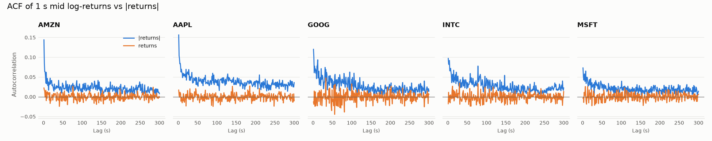
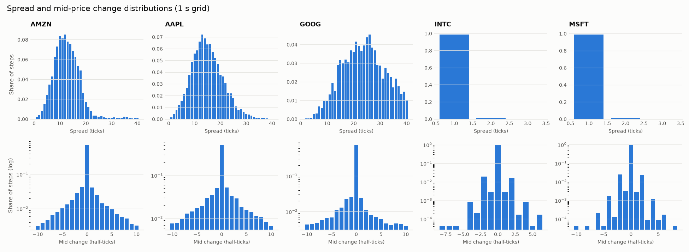

---

## 5. Usage

Create a virtual environment, install the packages in Section 3, then run everything from this folder.

```bash
# Check the data pipeline: per-ticker summary, split sizes and a first batch
python dataset.py --data-dir <path-to-lobster-csvs>

# Data audit: statistics, real-vs-real references and figures (written to figures/audit/)
python data_audit.py --data-dir <path-to-lobster-csvs>

# Train TimeGAN, all three phases
python train.py --data-dir <data> --model timegan --hidden-dim 164 --latent-dim 41 \
    --ae-iterations 20000 --sup-iterations 5000 --iterations 2000 \
    --lr <lr> --d-lr <d-lr> --d-steps 5 --run-name <name>

# Phase 3 only, reusing phases 1 and 2 from an earlier run with the same settings
python train.py --data-dir <data> --model timegan --hidden-dim 164 --latent-dim 41 \
    --init-from runs/<earlier-run> --iterations 2000 --run-name <name>

# Train the RCGAN baseline with every shared setting copied from a TimeGAN run, then benchmark it
bash scripts/train_rcgan_matched.sh runs/<timegan-run> <data> --device cuda

# Generate 500-step books for every ticker and benchmark them against the real test hour
python predict.py --run-dir runs/<name> --data-dir <data>
```

Main training options (`python train.py --help` lists all of them):

| Option | Meaning |
|---|---|
| `--model` | `timegan` or `rcgan` |
| `--hidden-dim`, `--latent-dim`, `--num-layers` | GRU hidden size, TimeGAN latent size, GRU depth |
| `--cond-dim` | ticker-embedding size; `0` trains an unconditional model |
| `--seq-len` | training window length |
| `--ae-iterations`, `--sup-iterations`, `--iterations` | phase 1, phase 2 and adversarial (phase 3 / RCGAN) iterations |
| `--lr`, `--d-lr` | learning rate of every network; separate discriminator learning rate |
| `--g-steps`, `--d-steps`, `--d-threshold` | generator and discriminator steps per iteration; skip a discriminator step when its loss is below the threshold |
| `--gamma`, `--sup-weight`, `--moment-weight`, `--e-sup-weight` | TimeGAN phase 3 loss weights (reference-code defaults) |
| `--init-from` | start TimeGAN at phase 3 from an earlier run's checkpoint |
| `--tickers`, `--representation` | subset of tickers; `unconstrained` (default) or `constrained` |
| `--device`, `--seed`, `--run-name`, `--out-dir` | hardware, reproducibility and output location |

**Outputs.** Each training run writes to `runs/<run-name>/` (not committed): `config.json` (all arguments, versions and resource figures), per-iteration loss CSVs and plots for each phase, and `checkpoint.pt`. `predict.py` writes to `runs/<run-name>/eval/`: `metrics.json`, a markdown summary table, depth heatmaps, ACF, spread and VWAP figures, and one real-vs-generated depth GIF per ticker (`--no-gifs` to skip; `--seq-len`, `--n-samples` and `--split` change what is generated and scored).

**Example input and output.** The input is a real 10-level book every second (40 numbers: price and size at each level on each side), encoded as 41 features per step. The output of `predict.py` is a decoded synthetic book in the same 40-column format, plus the metrics and figures in Section 7; the GIFs in Section 1 show one generated book next to the real one.

**Final runs**, exactly as used for Section 7:
```bash
python train.py --data-dir <data> --model timegan --device cuda --hidden-dim 164 --latent-dim 41 \
    --seq-len 64 --ae-iterations 20000 --sup-iterations 5000 --iterations 2000 \
    --lr 3e-5 --d-lr 1e-4 --d-steps 5 --seed 0 --run-name final_timegan
python predict.py --run-dir runs/final_timegan --data-dir <data>
bash scripts/train_rcgan_matched.sh runs/final_timegan <data> --device cuda
```
To avoid the underfitted autoencoder described in Section 7.1, phases 1 and 2 should be run at `--lr 1e-3` and phase 3 started from that checkpoint with `--init-from` and the lower learning rate.

---

## 6. Metric choice

The task sheet sets targets of **KL divergence ≤ 0.1** on the spread and mid-price returns, and **SSIM > 0.6** on depth heatmaps. Course staff advised that these are "slightly inappropriate" on their own and recommended additional metrics. Every spec metric is reported, alongside these recommended metrics:

| Metric | What it tests |
|---|---|
| **Order-book violations** (% crossed or locked, % ladder violations, % negative volume) | The hard rules: the core of the dilemma |
| **VWAP** `Σ P_i V_i / Σ V_i`, per side and for the whole book | Whether depth sits at realistic prices; its per-ticker variance and distance from the mid test conditioning without depending on price level |
| **ACF of returns and of \|returns\|** | No linear predictability, and volatility clustering |

`predict.py` also reports the spread in ticks and its one-tick share, the distance of prices from the $0.01 tick grid, return standard deviation and kurtosis, and violation rates and return volatility in the first versus the last 100 steps of each sequence (to detect long-horizon drift). Every metric is shown next to the same metric between two real hours.

Both KL divergence and SSIM metrics were computed between two real hours, the test hour against the validation hour. A generator cannot be expected to beat these values.

| Ticker | KL spread | KL mid change | SSIM depth (500-step segments) |
|---|---|---|---|
| AMZN | 0.286 | 0.174 | 0.111 |
| AAPL | 0.128 | 0.144 | 0.048 |
| GOOG | 0.141 | 0.166 | 0.125 |
| INTC | 0.001 | 0.025 | 0.326 |
| MSFT | 0.000 | 0.043 | 0.472 |

- **Real data fails both spec targets.** Spread KL for AMZN, AAPL and GOOG is above 0.1, and SSIM is below 0.6 for every stock.
- **KL depends on choices, not just the data.** With equal-width bins on log returns, GOOG's real-vs-real KL ranges from 0.02 with 10 bins to 0.37 with 200, and MSFT's is about 0.22 at every bin count because a bin edge splits identical one-tick moves between hours. KL also changes with the number of samples. KL is therefore computed on **tick-aligned bins** (one bin per whole tick of spread, or per half-tick of mid change, the smallest possible mid move), and models are compared with the real-vs-real value under identical bins and lengths.
- **SSIM rewards coincidence of timing, not realism.** It compares two heatmaps pixel by pixel, so it rewards the same pattern at the same time and level. Two independent hours, or a real hour and a generated one, share no timing. SSIM is highest for INTC and MSFT only because their stable queues make the heatmaps nearly uniform stripes. The experiments confirmed this: in EXP-012, generated books that were clearly unrealistic (smooth, static average books with drifting prices) scored SSIM **at or above** the real-vs-real reference for every ticker, while their KL was 15–100× the reference.

For these reasons the staff-recommended metrics (violations, VWAP statistics and the ACF) are treated as the primary evidence, and KL and SSIM are reported against their real-vs-real references rather than the fixed spec targets.

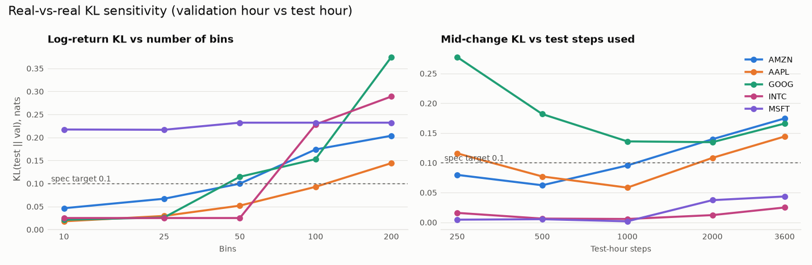
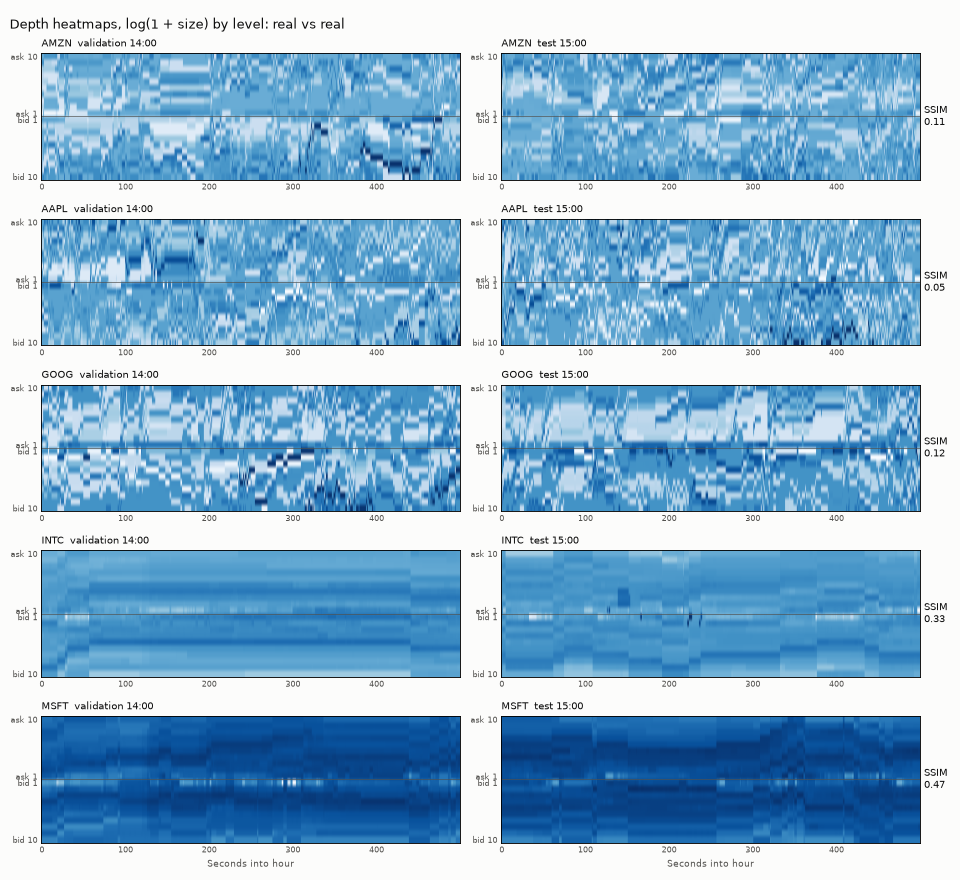

---

## 7. Results

All results: 32 generated sequences of 500 steps per ticker from each final model (EXP-013, EXP-014), decoded into books and scored against the real **test hour** (15:00–16:00) by `predict.py`. "Ref." is the same metric between the two real hours (validation vs test), the best realistically reachable value. One seed (Section 3).

### 7.1 Setup, and one confound to keep in mind
Both models used identical data, splits, window length (64), network sizes, noise, batch size, learning rates, update schedule and seed, copied automatically from the TimeGAN run (`scripts/train_rcgan_matched.sh`); RCGAN's generator and discriminator are the same size as TimeGAN's.

**The final TimeGAN's autoencoder is underfitted.** `--lr 3e-5` was meant to slow only the phase 3 fine-tuning, but it also set the learning rate of phases 1 and 2, which then ran 33× slower than in EXP-007. Validation reconstruction ended at 0.0045 instead of 0.0001, only slightly better than predicting each stock's average book (EXP-013). Every TimeGAN book is decoded through this weaker recovery network, so the TimeGAN results below are, if anything, a pessimistic estimate of what the method can do here. The RCGAN, which has no autoencoder, is unaffected.

### 7.2 Validity and conditioning

| Ticker | Violations TimeGAN / RCGAN | Spread (ticks) TimeGAN / RCGAN / real | One-tick share TimeGAN / RCGAN / real | VWAP variance ($²) TimeGAN / RCGAN / real | VWAP − mid (ticks) TimeGAN / RCGAN / real |
|---|---|---|---|---|---|
| AMZN | **0.0%** / 100% | 16.5 / 35.4 / 9.9 | 0% / 0% / 0.8% | 0.023 / 101 / 0.023 | −0.64 / +36.1 / −1.41 |
| AAPL | **0.0%** / 100% | 12.1 / 92.9 / 11.1 | 0% / 0% / 0.6% | 0.052 / 700 / 0.081 | −2.44 / +94.7 / −1.77 |
| GOOG | **0.0%** / 100% | 24.1 / 90.7 / 21.6 | 0% / 0% / 0% | 0.049 / 660 / 0.125 | −0.26 / +92.4 / −3.04 |
| INTC | **0.0%** / 100% | 1.00 / 4.16 / 1.01 | **100%** / 0% / 99.4% | 0.018 / 1.5 / 0.0004 | −0.42 / +4.37 / −0.34 |
| MSFT | **0.0%** / 100% | 1.00 / 4.98 / 1.01 | **100%** / 0% / 98.7% | 0.044 / 1.9 / 0.0003 | −0.01 / +4.93 / +0.03 |

- **TimeGAN never broke an order-book rule**: no crossed or locked books, no broken ladders and no negative volumes in any of the 80,000 generated snapshots, at the start and at the end of the 500 steps. **The RCGAN broke the price ladder on every snapshot** (but never crossed the spread).
- **TimeGAN kept the stocks apart:** INTC and MSFT kept a one-tick spread on every step, and AMZN, AAPL and GOOG kept wide spreads close to their real levels (AAPL and GOOG within 12%; AMZN 67% too wide). The RCGAN lost the one-tick regime entirely and produced spreads 3.6–8× too wide for the other stocks.
- **VWAP statistics:** TimeGAN matched AMZN's VWAP variance (0.0229 vs 0.0228) and was 36–61% low for AAPL and GOOG; for INTC and MSFT it was far too high, because their prices drift (Section 7.3). The RCGAN's VWAP sat tens of ticks above the mid, because almost all of its volume was in one ask level (Section 10).

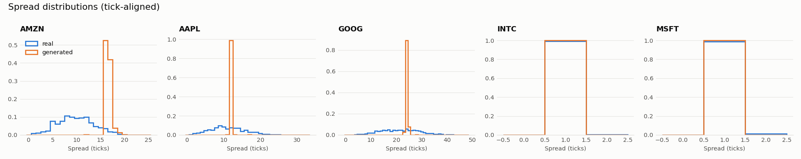
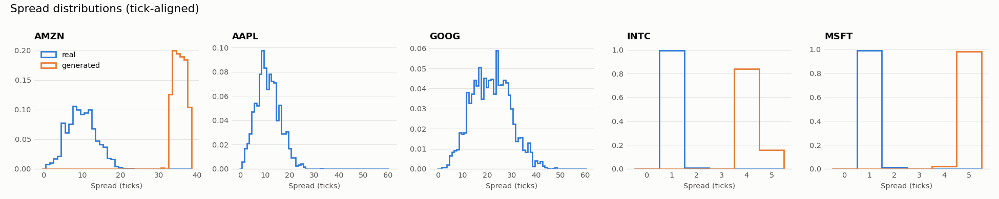
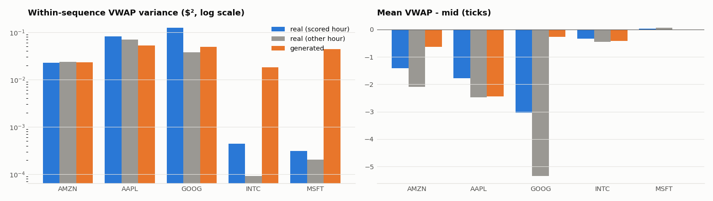

### 7.3 Temporal behaviour

| Ticker | Return std TimeGAN / RCGAN / real | ACF of returns, lag 1 TimeGAN / RCGAN / real | ACF of \|returns\|, lag 1 TimeGAN / RCGAN / real | Excess kurtosis TimeGAN / RCGAN / real |
|---|---|---|---|---|
| AMZN | 8.2e-6 / 9.5e-7 / 8.9e-5 | +0.61 / +0.96 / +0.07 | 0.84 / 0.96 / 0.13 | 47.6 / 10.2 / 41.4 |
| AAPL | 7.8e-6 / 9.0e-7 / 6.3e-5 | +0.79 / +0.97 / +0.09 | 0.79 / 0.97 / 0.11 | 67.4 / 8.7 / 38.5 |
| GOOG | 6.5e-6 / 9.3e-7 / 6.0e-5 | +0.92 / +0.97 / +0.02 | 0.80 / 0.97 / 0.10 | 2.0 / 10.4 / 18.5 |
| INTC | 7.4e-6 / 9.1e-7 / 8.1e-5 | +0.93 / +0.97 / +0.01 | 0.95 / 0.97 / 0.04 | 7.6 / 9.3 / 23.8 |
| MSFT | 1.0e-5 / 9.1e-7 / 8.9e-5 | +0.81 / +0.97 / −0.01 | 0.82 / 0.97 / 0.05 | 6.8 / 8.0 / 20.2 |

**Neither model reproduces real price dynamics.** Real 1-second returns are mostly zero with occasional jumps, uncorrelated from one second to the next (lag-1 ACF ≈ 0). Generated mid prices instead follow smooth, slowly bending curves: returns are 8–11× too small (TimeGAN) or 65–99× too small (RCGAN) in standard deviation, and strongly correlated from step to step (+0.61 to +0.97). Different noise gives almost the same path. The high ACF of |returns| is therefore a by-product of the smooth drift, not volatility clustering. TimeGAN's kurtosis is close to or above real for AMZN and AAPL, but on returns that are far too small, so this does not mean realistic tails.

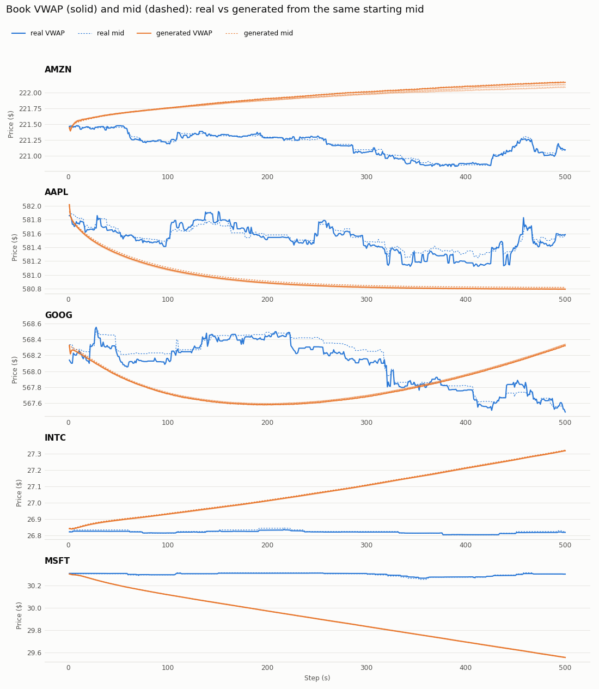
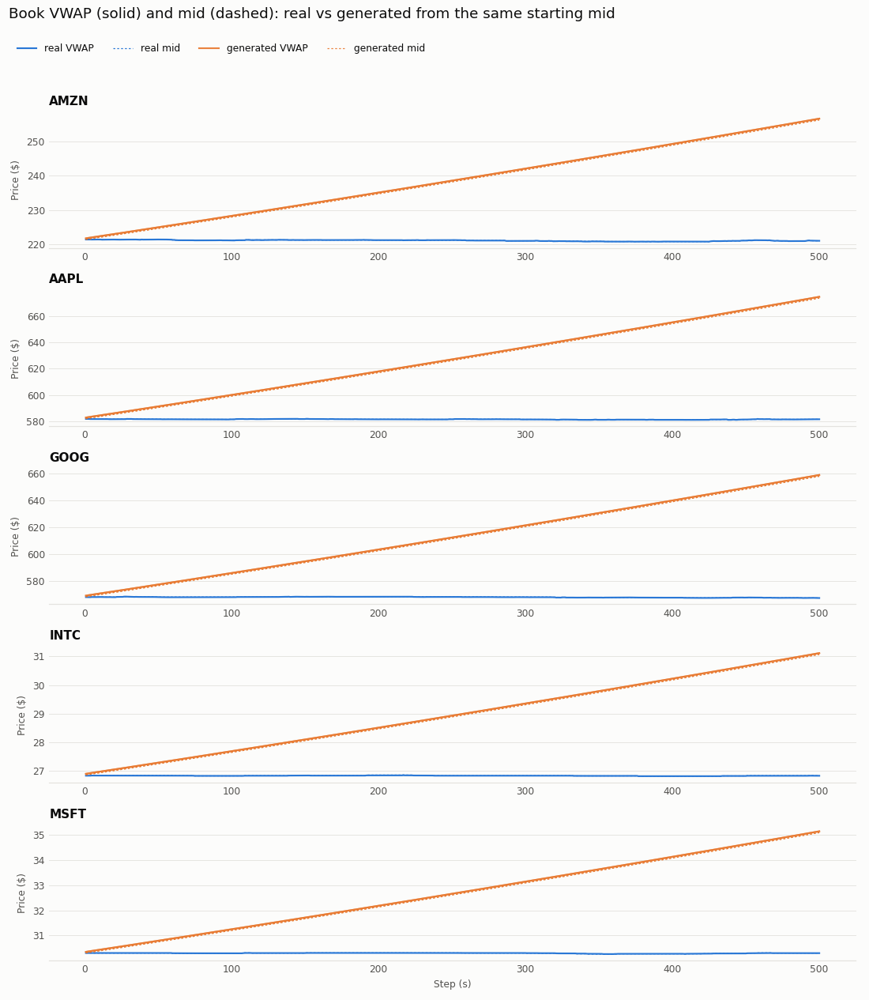
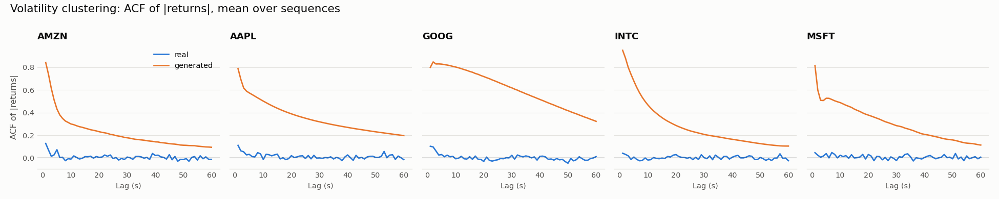

### 7.4 Spec metrics

| Ticker | KL spread TimeGAN / RCGAN (ref.) | KL mid change TimeGAN / RCGAN (ref.) | SSIM TimeGAN / RCGAN (ref.) |
|---|---|---|---|
| AMZN | 15.5 / 19.3 (0.26) | 2.9 / 20.1 (0.17) | 0.14 / −0.04 (0.10) |
| AAPL | 12.6 / 19.0 (0.12) | 6.4 / 19.4 (0.14) | 0.11 / −0.01 (0.04) |
| GOOG | 13.3 / 18.5 (0.13) | 3.3 / 20.2 (0.17) | 0.19 / −0.02 (0.12) |
| INTC | 0.10 / 21.9 (0.00) | 0.81 / 21.3 (0.02) | 0.34 / 0.04 (0.27) |
| MSFT | 0.21 / 21.9 (0.00) | 1.11 / 21.1 (0.04) | 0.54 / 0.04 (0.43) |

- **KL ≤ 0.1:** not met by either model (TimeGAN comes closest for INTC's spread, 0.10). KL is high mainly because generated prices are continuous and drifting, so they never reproduce the discrete, tick-by-tick distributions of real spreads and mid changes. TimeGAN's KL is lower than RCGAN's for every ticker and both quantities.
- **SSIM > 0.6:** not met by either model, nor by real data (Section 6). TimeGAN's SSIM is *at or above* the real-vs-real reference for every ticker, although its books are visibly smooth and static; this confirms that SSIM is not a good measure of realism here.

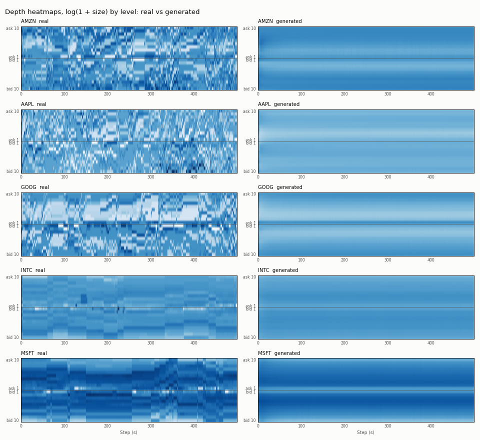
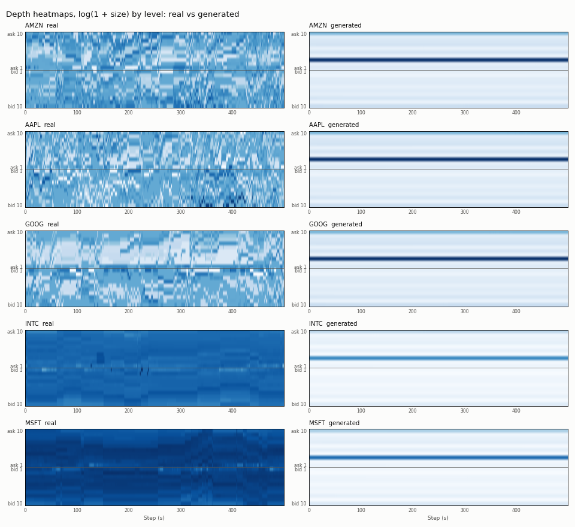

### 7.5 Horizon analysis
| | Violations, first 100 steps | Violations, last 100 steps | Violations at the training length |
|---|---|---|---|
| Final TimeGAN (64-step windows) | 0% | 0% | 0% (64 steps) |
| Final RCGAN (64-step windows) | 100% | 100% | 100% (64 steps) |
| EXP-012 TimeGAN (24-step windows), AMZN / GOOG | 1% / 0% | 100% / 100% | 0% (24 steps) |

In EXP-012, the book broke down only well beyond the training length; with 64-step windows the final TimeGAN stayed valid for the full 500 steps. Several things changed between those two runs, so this is consistent with, but does not prove, the longer window being the fix. The smooth-drift problem is present at every horizon, including the training length, so it is learned rather than caused by extrapolation.

### 7.6 Training behaviour
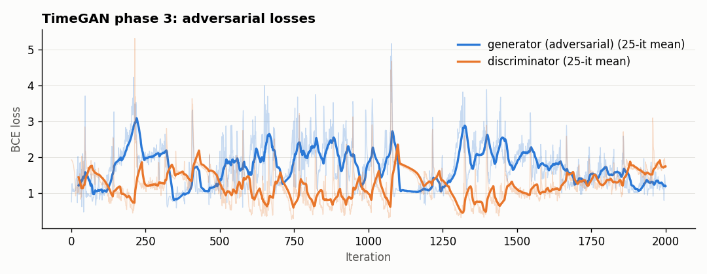
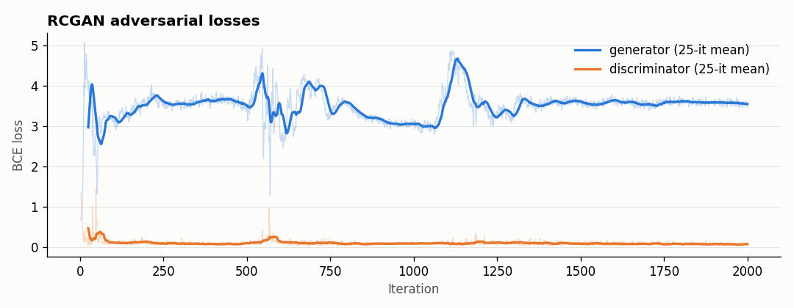

TimeGAN's adversarial game stayed balanced: its discriminator recognised 33–74% of real and 84–95% of generated latents (per 250 iterations) and every discriminator step was applied. With the same settings, the RCGAN's discriminator, which sees raw features rather than learned latents, won immediately (96–99% on real, 99–100% on generated) and its generator loss stayed at 3.2–3.6; the loss threshold then skipped 89% of its updates. The phase 1 plot of the final run (below) shows the slow, underfitted autoencoder.

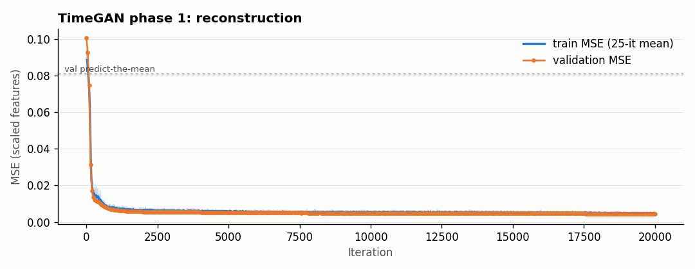

### 7.7 Against the acceptance criteria

| Criterion | Final TimeGAN | RCGAN baseline |
|---|---|---|
| 1. Violations < 1% and below RCGAN | **Met:** 0% for every ticker | Not met: 100% |
| 2. Conditioning: VWAP within ±30% and distinct; one-tick ≥ 90% for INTC/MSFT; wide spreads for the rest | **Partly met:** tickers distinct, one-tick 100%, wide spreads kept; VWAP variance within ±30% only for AMZN | Not met |
| 3. Volatility clustering: \|ACF r lag 1\| < 0.05, realistic ACF of \|r\| | Not met (smooth drift) | Not met |
| 4. Spec metrics reported against the reference, with SSIM critique | Reported (Sections 6, 7.4); KL far above reference | Reported; worse than TimeGAN |
| 5. < 30 min and < 2 GB on one T4 | Not met: 120 min; 3.5 GB peak (1.2 GB during adversarial training) | 34 min, 1.15 GB (without TimeGAN's pre-training phases) |

### 7.8 Answer to the engineering dilemma
On identical settings, **TimeGAN learned the hard order-book rules and the RCGAN baseline did not**: 0% against 100% invalid snapshots, and TimeGAN kept each stock's spread regime while the baseline confused them. This is the part of the dilemma TimeGAN's extra components were meant to address: a latent space learned from real (always valid) books, decoded by a recovery network, constrains generated books to valid shapes, and its discriminator works on that latent space instead of raw features. **Neither model learned realistic temporal behaviour.** Both collapsed to smooth, near-deterministic price drifts with no real jumps or volatility clustering, which is the "collapse into a single mode" failure the dilemma asks about. These conclusions rest on one seed, an underfitted TimeGAN autoencoder (7.1) and settings tuned on TimeGAN rather than separately for the baseline.

---

## 8. Resource profiling

**Parameter counts** at the final network size (hidden 164, latent 41, 3 GRU layers, ticker embedding 8; supervisor 2 layers):

| Network | TimeGAN | RCGAN baseline |
|---|---|---|
| Embedder | 437,305 | – |
| Recovery | 437,305 | – |
| Supervisor | 274,945 | – |
| Generator | 437,305 | 437,305 |
| Discriminator (bidirectional) | 1,184,121 | 1,184,121 |
| **Total** | **2,770,981** | **1,621,426** |

**Final runs** (Kaggle, one Tesla T4, 64-step windows, batch 128, 5 discriminator steps per iteration):

| | Iterations | Training time | Time per iteration | Peak VRAM |
|---|---|---|---|---|
| TimeGAN phase 1 (autoencoder) | 20,000 | 32.2 min | 0.097 s | 3,509 MB* |
| TimeGAN phase 2 (supervisor) | 5,000 | 5.3 min | 0.064 s | 2,916 MB* |
| TimeGAN phase 3 (joint) | 2,000 | 83.0 min | 2.49 s | 1,213 MB |
| **TimeGAN total** | | **120.5 min** | | |
| **RCGAN baseline** | 2,000 | **34.2 min** | 1.03 s | 1,150 MB |

\*Mostly from computing the validation loss on 2,048 windows in one batch, not from training itself.

| Generation (GPU, 160 sequences of 500 steps) | Time | Throughput | Latency per 500-step book | Peak VRAM |
|---|---|---|---|---|
| TimeGAN (generator → supervisor → recovery) | 0.84 s | 190 sequences/s (95,000 steps/s) | ~5 ms | 224 MB |
| RCGAN (generator) | 0.36 s | 448 sequences/s (224,000 steps/s) | ~2 ms | 219 MB |

- **Cost of TimeGAN over the baseline:** 1.7× the parameters, about 3.5× the training time, and 2.4× slower generation. Most of the training time is phase 3, where each iteration runs all five networks twice for the generator and five times for the discriminator.
- **Window length is the main cost driver:** recurrent networks process the steps one after another, so going from 24- to 64-step windows made each phase 2.5× slower per iteration (phase 3: 0.98 s → 2.49 s).
- **Against criterion 5 (< 30 min, < 2 GB):** not met by TimeGAN (120 min; 3.5 GB peak, though only 1.2 GB during adversarial training). Generation itself is cheap: thousands of 500-step books per minute on one T4.
- The feasibility review's estimate (15–20 min, < 1 GB) assumed the reference code's small networks and schedule; the larger networks (EXP-006), extra discriminator steps (EXP-011) and longer windows each multiplied the cost.

Earlier measurements at 24-step windows (EXP-007, EXP-009, EXP-012): phase 1 0.039 s/it, phase 2 0.026 s/it, phase 3 0.47 s/it with 1 discriminator step and 0.98 s/it with 5.

---

## 9. Experiment history

Every run, including failures, is recorded in [`EXPERIMENTS.md`](EXPERIMENTS.md).

| ID | Experiment | Outcome |
|---|---|---|
| EXP-001 | RCGAN smoke test, CPU | Pipeline works end to end; same-seed runs reproduce exactly; fixed a checkpoint-loading bug |
| EXP-002 | RCGAN smoke test, Tesla T4 | ~11× faster than CPU, 130 MB peak VRAM; CPU and GPU runs diverge slightly with the same seed |
| EXP-003 | TimeGAN phase 1 (autoencoder), hidden 24 | Reconstruction error fell quickly and without overfitting… |
| EXP-004 | Diagnostics of the EXP-003 autoencoder | …but per stock it barely beat predicting each stock's average book, captured little of how sizes and returns change, and damped returns. The pooled error had mostly measured the differences *between* stocks |
| EXP-005 | Unconditional autoencoder (`--cond-dim 0`) | Only 10–20% worse on average, but returns of the wide-spread stocks were lost entirely: conditioning matters for the dynamics. The first attempt crashed on CUDA (zero-width embedding), fixed with an explicit unconditional mode |
| EXP-006 | Phase 1 capacity sweep (hidden 24/64/164 × latent 24/41) | Hidden size was the main cause of underfitting; hidden 164 / latent 41 chosen. No overfitting at any size |
| EXP-007 | Phases 1 + 2 at 164 / 41, 20,000 + 10,000 iterations | Reconstruction 18–40× better than a static-book baseline; supervisor beats the "nothing changes" baseline for every stock; phase 2 overfits after ~4,500 iterations |
| EXP-008 | Phase 3 smoke test | Runs stably at 0.48 s per iteration; first sign of a discriminator that calls everything fake |
| EXP-009 | Phase 3, 2,000 iterations (reference schedule) | The discriminator never learned (a constant output matching the logged losses exactly), so there was no adversarial training; a fresh discriminator separated the output with 99% accuracy |
| EXP-010 | Phase 3 at learning rate 1e-4 | Discriminator still stuck; offline it could learn on fixed data, so the learning rate was not the cause |
| EXP-011 | Phase 3 with 5 discriminator steps per iteration | Small improvement only; an offline test showed each generator step undoing what 5–10 discriminator steps learned |
| EXP-012 | Phase 3 with a faster discriminator (TTUR), first full benchmark | Adversarial training worked for the first time, but generation was poor: smooth drifting prices, one trajectory per ticker, ladder violations growing with horizon. The ticker conditioning separated the two market regimes |
| EXP-013 | Final TimeGAN (64-step windows, faster discriminator, from scratch) | 0% violations at every horizon and stocks kept apart, but smooth drifting prices; the autoencoder underfitted because `--lr` also slowed phases 1 and 2 (an error in the run command) |
| EXP-014 | RCGAN baseline with settings copied from EXP-013 | Its discriminator won immediately; 100% ladder violations, spreads far too wide, almost all volume in one level |

**Planned but not run** (compute and time): the constrained representation, the invariant penalty loss, the optional C-RNN-GAN baseline, repeated seeds, and a nearest-neighbour memorisation check. The constrained representation is implemented in the pipeline and decoder; the penalty loss is not implemented.

---

## 10. Microstructure autopsy

Five representative failures, from the final models and from the experiments that led to them. Each has a symptom, a diagnosis of what went wrong in the book, and the trigger.

**1. Broken books from an overpowering discriminator (final RCGAN, EXP-014).**

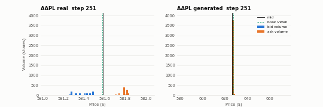

*Symptom:* every generated snapshot breaks the bid ladder (100%), spreads are 3.6–8× too wide, and the VWAP sits 36–95 ticks above the mid. Inspecting one AAPL book after 250 s: 2–7 shares at most levels, one order of about 3,800 shares at the third ask level, bid prices out of order, and a mid that has drifted from $581.9 to about $626. The depth heatmaps are almost empty apart from that one band (Section 7.4). *Diagnosis:* the generator found one output pattern and kept it; its loss stayed high (3.2–3.6) throughout. *Trigger:* with the settings tuned for TimeGAN, the baseline's discriminator, which sees raw features, separated real from fake 96–100% of the time from the start, so the adversarial loss gave the generator almost no useful direction (the loss threshold skipped 89% of discriminator updates). With nothing else in its loss (no reconstruction, no supervisor), nothing pushes the baseline towards valid book shapes. TimeGAN's discriminator, working on a latent space learned from valid books, stayed in balance under the same settings.

**2. Collapse to one smooth, drifting trajectory per ticker (both final models; EXP-012).**

*Symptom:* in the VWAP-path figures (Section 7.3), every generated mid follows a smooth curve, for example TimeGAN's MSFT falling steadily by about $0.75 in 500 s and INTC rising by about $0.50, while real prices move in discrete jumps and mostly stand still. Different noise gives nearly identical paths. Returns are 8–11× too small in standard deviation for TimeGAN and 65–99× for the RCGAN, with lag-1 autocorrelation of +0.61 to +0.97 (real ≈ 0). *Diagnosis:* the generators largely ignore their noise and produce one typical path per stock, so the high ACF of |returns| comes from the drift, not from volatility clustering. Heavy tails are inconsistent: TimeGAN's kurtosis is near or above real for AMZN and AAPL, but well below for the others, on returns that are far too small. *Trigger:* the damping is present even within the training length (EXP-012's 24-step check), so it is learned, not caused by extrapolation. Likely contributors: nothing in the losses rewards variety between samples (the moment loss only matches batch means and spreads); the largest real moves are clipped away in pre-processing (Section 4.5); continuous outputs make an exact "no change" impossible; and, for the final TimeGAN, an underfitted autoencoder that reconstructs returns poorly (Section 7.1).

**3. Long-horizon drift into broken ladders (EXP-012; fixed in the final TimeGAN).**

*Symptom:* in EXP-012, ladder violations for AMZN and GOOG rose from 0–1% in the first 100 steps to 100% in the last 100, while no book was ever crossed. *Diagnosis:* the same model had 0% violations when generating at its 24-step training length; the price offsets slowly drifted until two levels swapped order. *Trigger:* training on 24-step windows but generating 500 steps, so small biases compound far beyond anything seen in training. With 64-step training windows, the final TimeGAN had 0% violations in both the first and the last 100 steps (Section 7.5), consistent with the longer window being the fix, although other settings also changed.

**4. A discriminator stuck at a constant output (EXP-009 to EXP-011).**

*Symptom:* discriminator loss flat at about 1.87 and generator adversarial loss at about 1.10 for thousands of iterations; the discriminator called almost everything fake, real data included, so there was effectively no adversarial training. *Diagnosis:* those are exactly the losses of a discriminator that gives every input the same score (its loss has one "real" and two "fake" terms, so the best constant guess is P(real) = 1/3, giving ln 3 + 2 ln 1.5 ≈ 1.91 and ln 3 ≈ 1.10); the checkpoint confirmed it, and a fresh discriminator separated the same generated data with 99% accuracy. *Trigger:* not the learning rate and not a broken network (offline, the same discriminator learned within 100–300 steps), but the training balance: in the loop, each generator step erased what 5–10 discriminator steps had learned (EXP-011). The reference schedule (two generator steps per discriminator step, and skipping the discriminator when its loss is low) is designed for a discriminator that is too strong; here it was too weak. A faster discriminator (the two time-scale update rule) fixed it for TimeGAN (EXP-012), and is also what made the baseline's discriminator overpowering (case 1): the right balance depends on what the discriminator sees.

**5. Off-grid prices, and a metric that does not notice (both final models).**

*Symptom:* generated prices sit on average 0.25 ticks from the $0.01 grid, the same as random prices, while real prices are always exactly on it; KL on the tick-aligned spread and mid-change distributions is 15–100× the real-vs-real reference or more. Yet TimeGAN's SSIM was at or above the real-vs-real reference for every stock. *Diagnosis:* the unconstrained decoder produces continuous prices and never rounds them to valid ticks, so the discrete structure of real books (a spread of exactly 1, 2, 3… ticks; mid moves of whole half-ticks) is lost. *Trigger:* a design choice in the decoder, not the model. SSIM rewards smooth, average-looking heatmaps, which is the clearest evidence that it is a weak realism metric for order books (Section 6).

**Ticker confusion: avoided by TimeGAN, partly by the baseline.** TimeGAN kept the two market regimes apart in every benchmarked run: INTC and MSFT had a one-tick spread on 100% of steps (real 99%), and AMZN, AAPL and GOOG kept wide spreads close to their own levels (Section 7.2). The RCGAN still told the groups apart (4–5 ticks against 35–93), but lost the one-tick regime completely and gave AAPL and GOOG almost identical, far too wide spreads.

---

## 11. Recommendation to the project manager

**Recommendation: do not use these synthetic books to backtest trading or execution strategies yet.** Their structure is sound but their dynamics are not, and any strategy result would mostly reflect the generator's artefacts.

**What can be trustd** The conditional TimeGAN produces books that obey the hard rules: no crossed books, ordered ladders and non-negative volume in all 80,000 benchmark snapshots, out to 500 seconds. It reproduces each stock's spread regime (one tick for INTC and MSFT, wide and roughly right for AAPL and GOOG). That makes it usable now for:
- **testing software, not straegies:** feeding order-book parsers, risk checks, dashboards and simulators with valid, stock-specific books at scale (thousands of 500-second books per minute on one GPU);
- **static snapshot shapes**, for example depth-dependent cost estimates, where only the cross-section of the book matters and not how it evolves.

**What cannot be trusted.** Generated prices drift smoothly instead of jumping in ticks, are nearly the same for every sample, have no real volatility clustering, and sit between valid ticks. Anything that depends on price dynamics would be misleading: market-making and spread-capture strategies, execution and slippage, signals based on returns or order-flow changes, and risk measures driven by volatility or tail moves.

**Guardrails if used.**
1. Reject any book that fails the invariant checks (`utils.violation_rates`), and round prices to the $0.01 grid (or use the constrained representation, which is valid by construction).
2. Keep generation within the tested horizon (500 s for the final model), and re-run the horizon check before using longer sequences.
3. Never use the RCGAN baseline: it fails the basic validity checks on every snapshot.
4. Treat results as single-seed until repeated.

**Is TimeGAN's cost justified over the baseline?** Yes, in the sense that with identical settings and tuning effort only TimeGAN produced valid, stock-specific books; the baseline's output is unusable. TimeGAN costs 1.7× the parameters, about 3.5× the training time (2 hours on one T4, above the 30-minute target) and 2.4× slower generation, which is still cheap in absolute terms. It does not, however, solve the harder half of the problem: neither model learned realistic temporal behaviour.

**Next steps, in order of expected value.**
1. Re-train phases 1 and 2 at the intended learning rate (`--lr 1e-3`) and start phase 3 from that checkpoint; this removes the main confound in the final run (Section 7.1) and costs about two hours on one T4 (40 minutes for phases 1 and 2, 80 for phase 3).
2. Round decoded prices to the tick grid, and stop clipping mid returns (or clip them far less), so jumps and tail moves can be learned.
3. Add a term that rewards diversity between samples, or evaluate the generator's use of its noise directly, to tackle the single-trajectory collapse.
4. Train the constrained representation and the invariant penalty loss, and tune the baseline separately, for a complete comparison.
5. Repeat the final runs over 2–3 seeds.

---

## 12. Artificial Intelligence Usage Disclosure

The development of code an logging of experiments in this assignment Where completed using Claude Code (Anthropic, model Claude Opus 5.5)

The model was used to develop components of the code part by part and to explain at each step. To ensure I wasn't allowing it to do anything without properly understanding the reasoning for it's actions I made sure to enquire the reasoning at every step. I made sure to question any design decisions it had made and made sure i completely agreed with the reasoning. I would then review all the code manually to ensure i had a complete understanding of the implementation specifics. The code design for the TimeGAN architecture was largely based on the associated code base referenced in the TimeGAN paper (Yoon, Jarrett & van der Schaar, 2019) and thus i used this code base as a point of reference for any basic design choices.

The model was also used in places to fill in my understanding of topics that were being implemented or observed in experiments. For example I often used it to try and diagnose the cause of poor result performance of my models or to get a better understanding of implementation specific theory.

The full listing of AI usage for code development is listed in the AI_USAGE_LOG.md. This file completely describes every instance i used for code development. However, it does not list every instance I used AI for in total. It does not include it's own usage in documenting entries into AI_USAGE_LOG.md (however, verification entries where entered by me). It includes its use to document the results of *some*, but not all, experiments when they were done in conjunction with code development. It had been used to document every experiment but had been instructed to only include code development tasks. The model was also used to write the majority of this report based on a draft i had given it which was a detailed scaffold of how i wanted the report laid out. These use cases where each verified by a manual readthrough of each document that it had typed up and each entry that it wrote. 


---

## 13. References

- Ané, T. & Geman, H. (2000). Order flow, transaction clock, and normality of asset returns. *The Journal of Finance*, 55(5), 2259–2284.
- Clark, P. K. (1973). A subordinated stochastic process model with finite variance for speculative prices. *Econometrica*, 41(1), 135–155.
- Cont, R. (2001). Empirical properties of asset returns: stylized facts and statistical issues. *Quantitative Finance*, 1(2), 223–236.
- Esteban, C., Hyland, S. L. & Rätsch, G. (2017). Real-valued (medical) time series generation with recurrent conditional GANs. arXiv:1706.02633.
- Heusel, M., Ramsauer, H., Unterthiner, T., Nessler, B. & Hochreiter, S. (2017). GANs trained by a two time-scale update rule converge to a local Nash equilibrium. *Advances in Neural Information Processing Systems 30 (NeurIPS 2017)*.
- LOBSTER: Limit Order Book System, the Efficient Reconstructor. Sample files: https://lobsterdata.com/info/DataSamples.php
- Mirza, M. & Osindero, S. (2014). Conditional generative adversarial nets. arXiv:1411.1784.
- Wang, Z., Bovik, A. C., Sheikh, H. R. & Simoncelli, E. P. (2004). Image quality assessment: from error visibility to structural similarity. *IEEE Transactions on Image Processing*, 13(4), 600–612.
- Yoon, J., Jarrett, D. & van der Schaar, M. (2019). Time-series generative adversarial networks. *Advances in Neural Information Processing Systems 32 (NeurIPS 2019)*.
- Yoon, J. TimeGAN reference implementation: https://github.com/jsyoon0823/TimeGAN
